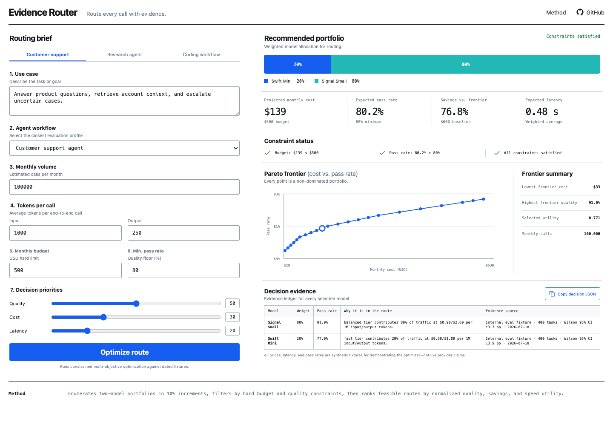

# Evidence Router

**Route every AI call with evidence.** Evidence Router is a zero-setup smart-routing demo that turns a use case, agent workflow, monthly budget, and minimum pass rate into an auditable weighted model portfolio.

[Live demo](https://ktwu01.github.io/evidence-router/) · [Method](#how-the-router-works) · [Design spec](docs/superpowers/specs/2026-07-20-evidence-router-design.md)



## What it returns

- A weighted model allocation for the selected workflow
- Projected monthly API cost from call and token volume
- Savings against an all-frontier baseline
- Expected pass rate and latency
- Budget and quality constraint checks
- A cost/quality Pareto frontier
- A dated evidence ledger and copyable JSON decision record

The application ships with three runnable scenarios: customer support, research, and coding. It requires no account, API key, backend, or provider access.

## How the router works

The router enumerates one- and two-model portfolios in 10% increments. For each portfolio it forecasts weighted cost, pass rate, and latency, rejects combinations that violate the monthly budget or pass-rate floor, and ranks the remaining routes using the user's normalized quality, cost, and speed priorities.

If no portfolio satisfies both hard constraints, the router returns the least-violating route and quantifies both shortfalls. It never hides an infeasible request behind an empty result.

```text
maximize  w_quality × pass_rate
        + w_cost    × savings
        + w_speed   × normalized_speed

subject to monthly_cost ≤ budget
           pass_rate   ≥ quality_floor
```

All bundled prices, latency measurements, and pass rates are **synthetic, dated fixtures** designed to demonstrate the optimizer. They are not current provider claims. Replacing `src/data/models.ts` with benchmark observations is the intended extension point.

## Relationship to API gateways

Evidence Router is the decision layer, not a relay or credential broker. A production integration can send its selected model and weight policy to a compliant customer-owned gateway—such as a separately deployed OpenAI-compatible router—while keeping provider credentials, authorization, logs, and billing outside this demo.

The project does not pool subscriptions, resell provider accounts, store API keys, or proxy live traffic.

## Run locally

```bash
npm install
npm run dev
```

Open the URL printed by Vite.

## Verify

```bash
npm test -- --run
npm run build
```

For visual QA, start the dev server at Vite's default port and run:

```bash
npm run qa:visual
```

This checks preset recomputation, JSON-copy feedback, desktop/mobile screenshots, and mobile overflow using Playwright with local Chrome.

## Architecture

```text
src/data/models.ts       dated model fixtures
src/lib/router.ts        forecasting + constrained optimization + Pareto filter
src/lib/router.test.ts   deterministic behavior tests
src/components/          form, portfolio, chart, and evidence surfaces
scripts/visual-qa.mjs    browser interaction and responsive checks
```

React and TypeScript render a static Vite application. The routing engine is implemented as pure functions and can run in a browser, test runner, or future service without UI dependencies.

## Author

Built by [Koutian Wu](https://github.com/ktwu01) as an AI infrastructure and model-evaluation demo.

## License

MIT
